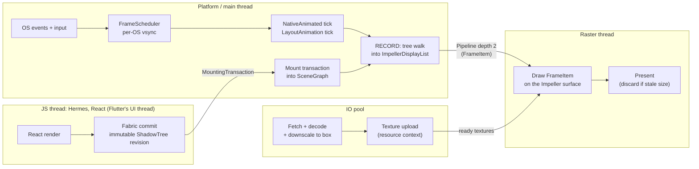
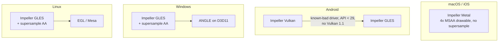
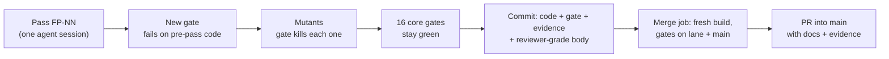

# Diagrams: Flutter-parity rendering engine

Rendered by GitHub (Mermaid). The PR descriptions embed the first two. Sources for every box are in SPEC.md.

## 1. Target thread model (Flutter's platform / UI / raster / IO, the RN way)

## 2. Backend per OS (what Flutter ships, so what we ship)

## 3. How every change lands

